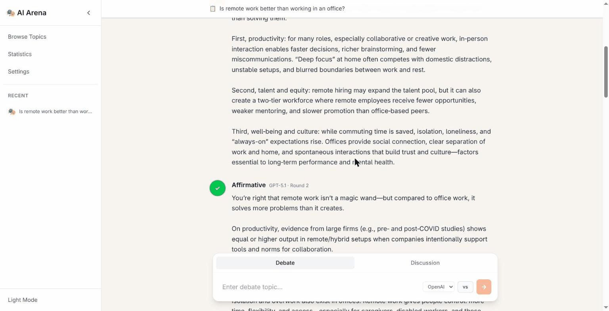

# AI Debate Arena

[](https://github.com/AndreKalberer/ai-debate-arena/actions/workflows/ci.yml)

A full-stack application where OpenAI, Claude, and Gemini debate opposing positions or discuss a topic together. Responses stream into a React interface as they are generated.

**[Live demo](https://aidebatearena.vercel.app)** · [Engineering notes](docs/engineering.md)



## Features

- **Debates:** opening statements, configurable rebuttal rounds, closing statements, moderator analysis, and three judge verdicts.
- **Discussions:** three models take turns, with heuristic consensus detection and judge voting when no consensus is found.
- **Streaming:** Express sends SSE events for response chunks, completed messages, progress, and results.
- **History:** the browser retains the latest 50 conversations, model win/loss/tie statistics, and Markdown exports.
- **Interface:** responsive layouts, light/dark themes, topic browsing, and optional Firebase sign-in.

## Architecture

The frontend uses **React, TypeScript, Vite, and Tailwind CSS**. The backend uses **Node.js, Express, and TypeScript**, with separate OpenAI, Anthropic, and Google adapters.

- **SSE for one-way updates:** forward provider chunks without waiting for a full response. Message indices associate chunks with the correct response.
- **Provider adapters:** isolate SDK response formats while controllers manage prompts and turn order.
- **Browser-local history:** use localStorage without a database. Firebase provides optional sign-in; saved conversations do not synchronize across devices.
- **Independent hosting:** Vercel serves the frontend; Render hosts Express. A build-time backend URL connects them.

See [engineering notes](docs/engineering.md) for the event protocol, tradeoffs, and latency measurement procedure.

## Run locally

Use **Node.js 24 or later** and npm. Real debates require your provider API keys and may incur provider charges.

```sh
git clone https://github.com/AndreKalberer/ai-debate-arena.git
cd ai-debate-arena
npm ci
npm ci --prefix debate-ui
```

Copy the backend example to `.env` and the frontend example to `debate-ui/.env.local`.

macOS/Linux:

```sh
cp .env.example .env
cp debate-ui/.env.example debate-ui/.env.local
```

Windows PowerShell:

```powershell
Copy-Item .env.example .env
Copy-Item debate-ui/.env.example debate-ui/.env.local
```

Fill in `OPENAI_API_KEY`, `ANTHROPIC_API_KEY`, and `GOOGLE_API_KEY` in the root `.env`. The backend validates all three at startup. Set `VITE_API_BASE_URL=http://localhost:5050` in `debate-ui/.env.local`; configure the optional Firebase values there to enable sign-in.

Build and start the backend:

```sh
npm run build
npm start
```

In a second terminal, from the repository root:

```sh
npm run dev --prefix debate-ui
```

Open the URL printed by Vite (normally `http://localhost:5173`). After backend edits, rebuild and restart it.

## Verify changes

```sh
npm test
npm run build
npm run build --prefix debate-ui
```

GitHub Actions runs these checks on pushes and pull requests using Node.js 24 and the committed lockfiles.

Tests exercise real saved-history, statistics, and Markdown-export logic with in-memory browser storage. They cover history eviction, deletion, malformed JSON recovery, majority/tied votes, self-debate exclusion, and discussion exports.

Tests require **no API keys and make no AI requests**. They do not verify live providers, streaming, sign-in, or deployed services. The scripts in `src/tests/` remain separate manual provider checks.

## Project layout

```text
debate-ui/src/          Active React frontend and browser storage logic
src/server.ts          Express JSON and SSE routes
src/lib/ai/            Provider adapters
src/lib/debate/        Debate/discussion controllers and judging
src/lib/config/env.ts  Backend environment validation
tests/                 Credential-free regression tests
docs/                  Demo and engineering notes
```

Similarly named UI files under the root `src/` are retained from earlier development; the active frontend is `debate-ui/`.

## Deployment

- **Backend:** build with `npm ci && npm run build`, start with `npm start`, and configure the three provider keys.
- **Frontend:** use `debate-ui` as the project root, build with `npm run build`, and publish `dist/`. Set `VITE_API_BASE_URL` before building.
- Configure frontend Firebase values if sign-in is enabled.

## Current limitations

Consensus uses keyword matching, and judge verdicts are model opinions. Provider availability and latency vary. History is browser-local and can be removed when browser data is cleared. The checked-in backend does not verify Firebase tokens on its debate routes.

## License

[MIT](LICENSE).
